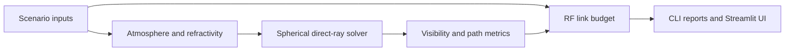
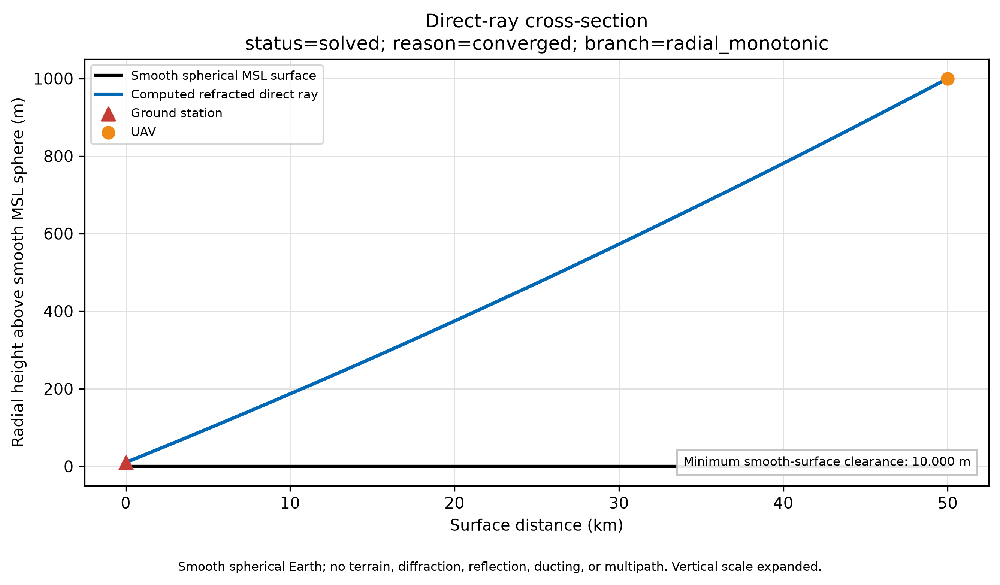
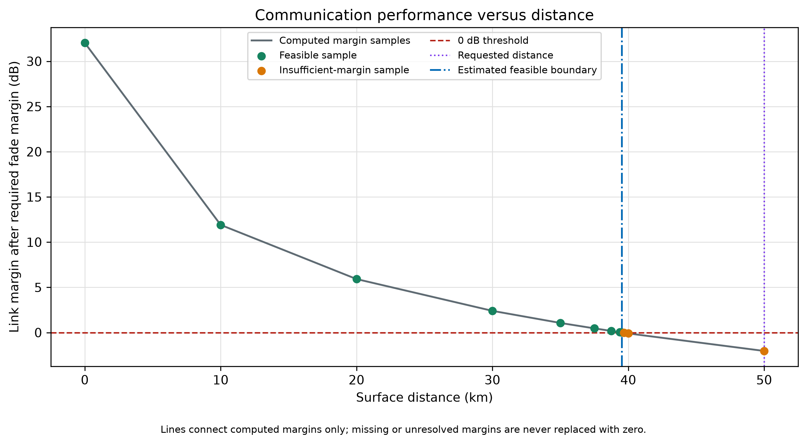

# UAV Communication Analysis Suite

UAV-CAS is an offline Python engineering tool for analyzing air-to-ground radio
links in a refracting atmosphere. It combines reference atmospheric profiles,
spherical-Earth direct-ray tracing, link-budget calculations, reproducible
report generation, and an interactive Streamlit dashboard in one installable
package.

The project is intended for preliminary UAV link studies, altitude and range
trade studies, propagation-method comparisons, and traceable engineering
reports. It is not a flight-safety tool or an operational coverage guarantee.

## Architecture



The installable `uav_cas` package is independent of the UI. The reporting layer
uses the same public atmosphere, propagation, and link-budget components as the
command-line workflows.

## Engineering capabilities

- Dry ISA-1976 and ITU-R P.835-7 annual low-latitude reference atmospheres.
- ITU-R P.453-14 dry/wet radio refractivity and refractive-index profiles.
- Spherical, horizontally stratified direct-ray solution using the Bouguer
  invariant and piecewise-linear refractive-index profiles.
- Explicit radial, radial-monotonic, and single-minimum ray branches, with
  blocked, grazing, unsupported, invalid-input, and numerical-failure states.
- Independent geometric line-of-sight and effective-Earth-radius references;
  neither substitutes for a failed ray solve.
- ITU-R P.525-5 free-space loss, received power, and link-margin accounting.
- Deterministic JSON, CSV, and PNG reports plus an interactive Streamlit UI.

## Installation

UAV-CAS supports Python 3.11 through 3.13. From a PowerShell prompt:

```powershell
py -3.11 -m venv .venv
.\.venv\Scripts\python.exe -m pip install --upgrade pip
.\.venv\Scripts\python.exe -m pip install -e ".[reporting]"
```

The reporting extra installs NumPy, Matplotlib, and Streamlit. No separate
legacy package or root-level requirements file is needed.

## Run

Start the dashboard:

```powershell
.\run_reporting_ui.bat
```

Or launch it directly:

```powershell
.\.venv\Scripts\python.exe -m streamlit run reporting_app.py
```

Generate a report bundle from the command line:

```powershell
.\.venv\Scripts\uav-cas-report.exe --output-dir outputs\reporting
```

Generated report files remain local and are not committed to the repository.
Additional installed workflows are `uav-cas-atmosphere-demo`,
`uav-cas-phase2a-demo`, and `uav-cas-phase2b-demo`.

## Recorded 50 km example

The default reporting scenario uses a 10 m MSL ground antenna, a UAV at
1,000 m MSL, 50 km surface separation, and a 2.4 GHz link. RF inputs are
30 dBm transmit power, 2 dBi gain at each endpoint, 1 dB loss at each endpoint,
-100 dBm receiver sensitivity, and 0 dB required margin. The atmosphere is the
ITU-R P.835-7 annual low-latitude reference profile with P.453-14 refractivity.

For the recorded run, the direct ray solved on the radial-monotonic branch. Its
geometric path length was 50,013.648 m and the minimum smooth-surface clearance
was 10.0 m. Free-space path loss was 134.034 dB, received power was
-102.034 dBm, and link margin was -2.034 dB. The ray was clear, but the stated
RF configuration did not meet the receiver threshold. These values are a
deterministic model result, not field validation.





## Scientific assumptions and limitations

- Earth is a smooth sphere referenced to mean sea level; terrain and surface
  elevation are not modeled.
- The atmosphere is horizontally homogeneous and taken from a reference model,
  not measured or forecast weather at a specific location.
- The supported production family is the nonducting direct ray. Ducting and
  multipath are outside the supported domain.
- Free-space spreading uses endpoint chord distance. Atmospheric gas and rain
  attenuation, diffraction, reflection, clutter, vegetation, interference,
  polarization mismatch, focusing/defocusing, and fading statistics are not
  included.
- A clear ray establishes geometric/ray visibility only; it does not establish
  adequate link margin or service availability.
- Results are deterministic engineering estimates and have not been presented
  as experimental validation or guaranteed operational range.

## References

- ITU-R P.453-14, *The radio refractive index: its formula and refractivity data*.
- ITU-R P.525-5, *Calculation of free-space attenuation*.
- ITU-R P.835-7, *Reference standard atmospheres*.
- ITU-R P.834-9, *Effects of tropospheric refraction on radiowave propagation*.
- U.S. Standard Atmosphere, 1976.
