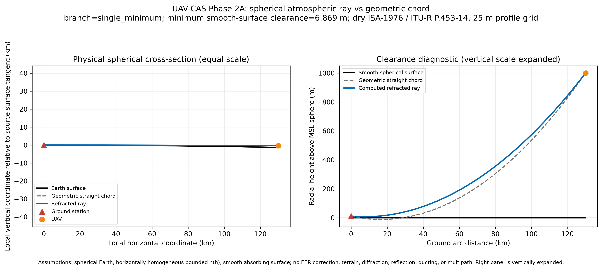

# UAV Communication Analysis Suite (UAV-CAS) — Phase 2A Progress

## 1. Milestone outcome

Phase 2A implements and verifies the initial bounded, nonducting subset of the planned spherical endpoint boundary-value solver for **UAV-to-ground atmospheric radio propagation**. The additive `trace_spherical_between` API connects unequal- or equal-height endpoints on a physical sphere, supports reversed source/receiver configurations under the scalar reciprocal model, and returns a sampled physical ray, optical quantities, endpoint residuals, invariant checks, clearance, and explicit solver diagnostics.

The preserved CubeSat `trace_spherical` API and its data contracts were not rewritten. Effective Earth Radius (EER) remains an independent analytical reference and is neither imported by the new core solver nor used as a fallback. This milestone stops before coverage search, GUI work, CubeSat extensions, terrain, ducting, or multipath.

## 2. Phase 1 baseline verified before implementation

The attached Phase 1 snapshot and repository report both described the same scientific baseline: bounded piecewise-linear refractivity profiles, explicit propagation statuses, independent physical-sphere geometric and EER references, and 38 original CubeSat tests plus 26 Phase 1 tests.

Before changing solver code, the configured CPython 3.13.18 environment was rerun:

```text
64 passed, 15 subtests passed in 8.45 s
```

This confirmed the reported Phase 1 regression baseline. After Phase 2A:

```text
Original CubeSat suite only: 38 passed, 15 subtests passed in 7.10 s
New Phase 2A suite only:     10 passed in 1.99 s
Combined repository suite:  74 passed, 15 subtests passed in 10.22 s
```

These are numerical and software verification results, not experimental propagation validation.

## 3. Implemented solver equations

For a spherically symmetric phase index `n(r)`, define

```text
q(r) = n(r) r
b    = n(r) r cos(theta)
```

where `theta` is signed ray elevation relative to the local horizontal in the direction of propagation. The conserved Bouguer invariant is `b`. On a radial leg,

```text
dphi/dr = b / [r sqrt(q(r)^2 - b^2)]
ds/dr   = q(r) / sqrt(q(r)^2 - b^2)
dQ/dr   = (n(r)-1) ds/dr
```

with

```text
L   = integral ds
Q   = integral (n-1) ds
OPL = L + Q
t   = OPL / c
excess delay = (OPL - endpoint chord) / c
```

At a radial minimum `r_min`, `q(r_min)=b`. The substitution

```text
r = r_min + u^2
```

regularizes the square-root tangent singularity. Integrals are split at every refractivity-profile knot. The implementation extends the existing CubeSat vector adaptive-Simpson and bounded-bisection approach with per-result work/error diagnostics, generic endpoints, reversed orientation, a two-leg single-minimum family, path reconstruction, and clearance classification.

No effective radius enters these equations. The physical Earth and surface radii are used unchanged.

## 4. Implemented capability envelope

The initial verified subset supports:

- Sphere-centred Cartesian source and receiver endpoints on a declared physical sphere.
- A UAV adapter using endpoint MSL heights and ground arc distance.
- Strictly bounded, piecewise-linear `n(h)` profiles with no extrapolation or implicit vacuum tail.
- Short-arc radial rays, unequal-height radial-monotonic rays, and one inward-then-outward radial-minimum family.
- Equal-height nonradial endpoints through the single-minimum family.
- Reversed high-to-low configurations by explicit path orientation; the reverse ray preserves length, OPL, and invariant under the static scalar-index assumptions.
- Launch, incident, and receive-look elevations; endpoint tangent vectors; geometric length, refractivity integral, OPL, travel time, and excess delay.
- Sampled three-dimensional ray coordinates, minimum smooth-surface clearance, and invariant reconstruction diagnostics.
- Explicit `solved`, `blocked_within_model`, `unsupported_model`, `unsupported_branch`, `missing_data`, `numerical_failure`, and `invalid_input` outcomes.

The declared default local domain is a central angle below `0.35 rad`. The solver requires strictly increasing `q(r)=n(r)r` over the explored path/clearance domain. It does not claim completeness outside that family.

## 5. Branch and failure handling

| Condition | Returned handling |
|---|---|
| Monotonic radial connection | `solved`, branch `radial` or `radial_monotonic` |
| One clear lower radial minimum | `solved`, branch `single_minimum` |
| Tangency within the declared 0.05 m clearance tolerance | `blocked_within_model`, reason `ground_grazing`; boundary path and uncertainty retained |
| Requested angle beyond the ground-grazing boundary | `blocked_within_model`, reason `ground_intersection`; no forced path |
| `q'(r) <= 0` | `unsupported_branch`, reason `nonmonotonic_q`; no duct/turning search |
| Profile does not cover an endpoint or required clearance domain | `missing_data` |
| Short-arc domain exceeded | `unsupported_model`, reason `local_domain_exceeded` |
| Root work exhausted or endpoint tolerance missed | `numerical_failure`, reason `endpoint_residual` |
| Invalid/coincident/below-surface endpoints | Explicit invalid or blocked result |

The solver never converts one of these outcomes to an EER result. Analytical references may be run separately by a comparison service, but cannot repair or overwrite a ray status.

## 6. Numerical verification

### 6.1 Constant-index and spherical limits

The exported constant-index controls verify that rays become exact straight chords on the physical sphere:

| Case | Branch | `L - chord` | Cartesian endpoint error | Angular residual |
|---|---|---:|---:|---:|
| `n=1`, 10 m to 1,000 m, 50 km arc | radial-monotonic | `+2.05e-6 m` | `2.03e-6 m` | `3.19e-13 rad` |
| `n=1.0003`, equal 1,000 m endpoints, 50 km arc | single-minimum | `-1.70e-5 m` | `1.71e-5 m` | `-2.68e-12 rad` |

For constant `n`, the verified optical limit is `OPL=n*chord`. The equal-height minimum radius also agrees with the analytic straight-chord value `(R+h) cos(phi/2)` within `2e-4 m`. The exact radial limit is separately tested.

### 6.2 Endpoint, invariant, and independent integration checks

- Successful rays must meet both angular and Cartesian endpoint tolerances; the default targets are `1e-10 rad` and `0.1 m`, while the UAV adapter derives a compatible angular target from its metre tolerance.
- The sampled dry-atmosphere invariant error decreases under path-sample refinement from 21 through 201 points.
- A separate Cartesian RK4 integration of `d(n u)/ds = grad(n)`, using independent profile interpolation and no production Bouguer quadrature or root solve, reaches the solved endpoint within `0.05 m`; its 20 m-to-10 m step refinement changes the endpoint by less than `0.02 m`.
- Tightening root/quadrature controls changes the 130 km ray length by `4.31e-5 m` from default to tight, compared with `3.13e-3 m` from loose to default; the refractivity-integral changes are `1.18e-8 m` and `8.59e-7 m`, respectively.
- A one-iteration deliberate root-work limit returns `numerical_failure` rather than a nearby or reference-model path.

### 6.3 Profile-grid convergence

The demonstration ray was recomputed with dry ISA/P.453 profile grids of 200, 100, 50, and 25 m. The launch-elevation changes decrease successively:

```text
200 -> 100 m: 1.69008e-4 deg
100 ->  50 m: 6.41225e-5 deg
 50 ->  25 m: 2.35726e-5 deg
```

Minimum clearances are `6.8417`, `6.8599`, `6.8665`, and `6.8687 m`. Profile discretization, root/quadrature settings, and path sampling are recorded separately; numerical precision does not imply atmospheric-input or field-prediction accuracy.

## 7. Reproducible UAV demonstration

The presentation case uses:

```text
Earth/MSL surface radius: 6,371,000 m
Ground antenna height:    10 m MSL
UAV height:               1,000 m MSL
Ground arc distance:      130,000 m
Frequency:                2.4 GHz
Atmosphere:               dry ISA-1976 + ITU-R P.453-14
Profile domain/grid:      0–5,000 m / 25 m
```

The computed result is a clear `single_minimum` ray:

| Quantity | Value |
|---|---:|
| Endpoint chord | `130,011.817976 m` |
| Curved geometric ray length | `130,011.875809 m` |
| Refractivity integral `Q` | `34.410282 m` |
| Optical path length | `130,046.286091 m` |
| Excess delay relative to vacuum chord | `114.973 ns` |
| Minimum smooth-surface clearance | `6.868749 m` |
| Source elevation | `-0.0518553 deg` |
| Angular endpoint residual | `-3.78024e-10 rad` |
| Cartesian endpoint error | `0.002409 m` |
| Reconstructed invariant maximum relative error | `3.73984e-9` |

The geometric straight chord intersects the idealized surface for this case, while the computed refracted ray remains above it within the supported scalar model. This is a numerical model comparison, not evidence of real-world link availability.



The left panel uses the same kilometre scale in both directions and therefore shows the real geometric compression. The right panel expands the vertical scale explicitly to reveal clearance; it must not be interpreted as an equal-aspect path plot.

Machine-readable outputs:

- [Sampled ray path CSV](../outputs/phase2a/phase2a_ray_path.csv)
- [Profile convergence CSV](../outputs/phase2a/phase2a_profile_convergence.csv)
- [Constant-index verification CSV](../outputs/phase2a/phase2a_constant_index_verification.csv)
- [Complete result and diagnostics JSON](../outputs/phase2a/phase2a_summary.json)
- [300 dpi scientific figure](../outputs/phase2a/phase2a_uav_ray_cross_section.png)

Reproduction:

```powershell
.venv-science\Scripts\python.exe -m pytest -q
.venv-science\Scripts\python.exe -m uav_cas.phase2a_demo --output-dir outputs\phase2a
```

## 8. Software changes

- `packages/cubesat-link/cubesat_link/ray_types.py`: additive immutable ray settings, path, diagnostic, status, and result contracts.
- `packages/cubesat-link/cubesat_link/ray_bvp.py`: additive `trace_spherical_between` solver; legacy `neutral.py` is unchanged.
- `src/uav_cas/propagation/ray_tracing.py`: bounded UAV profile and endpoint adapter with no EER option.
- `src/uav_cas/phase2a_demo.py`: deterministic calculation, CSV/JSON export, convergence controls, and figure generation.
- `src/uav_cas/visualization/ray_path.py`: equal-scale physical section plus explicitly expanded clearance diagnostic.
- `tests/test_ray_bvp.py` and `tests/test_phase2a_demo.py`: ten Phase 2A verification cases.

## 9. Explicit limitations and deferred work

- Only a scalar, spherically symmetric, horizontally homogeneous refractive index is supported.
- `q(r)` must be strictly increasing. Atmospheric ducts, upper turning layers, multiple eigenrays, caustics, and nonmonotonic/multipath branch enumeration are unsupported and reported as such.
- The direct family has at most one lower radial minimum. Long/antipodal paths and central angles outside the declared local domain are unsupported.
- The internal-minimum search conservatively requires bounded profile coverage down to the smooth surface. It does not infer missing lower atmosphere.
- Ground is a smooth absorbing sphere. Terrain, geoid variation, vegetation, buildings, reflection, diffraction, scattering, and Fresnel-zone clearance are absent.
- A ray tangent to ground within clearance tolerance is classified as blocked and retains an uncertainty diagnostic; no reflected/surface-wave path is inferred.
- `n` is used as a nondispersive phase index for OPL/time. No group-index model, ray-tube focusing/amplitude, verified atmospheric absorption generator, rain/cloud loss, or full-wave power transfer is included.
- Reciprocity applies only to this static scalar medium. Moving-medium, polarization, antenna pattern, and hardware directionality are outside the ray BVP.
- No range/coverage solver, feasibility intervals, map, GUI, executable, or CubeSat-specific extension is included in Phase 2A.
- No measured atmosphere or field dataset was supplied, so no empirical error bound or operational range claim is possible.

## 10. Milestone boundary

Phase 2A is complete at the requested solver-foundation boundary. The next Phase 2 work should not begin until this supported family and its limitations are accepted. Remaining Phase 2 work includes broader branch-completeness analysis, stronger quadrature/shooting convergence campaigns near singular limits, measured/imported profile cases, and any separately approved attenuation or comparison-service integration. Coverage remains a later phase.

